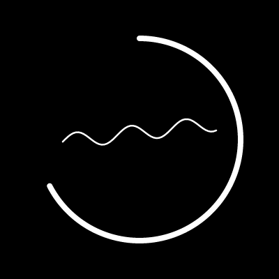
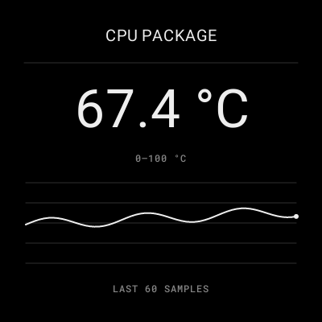
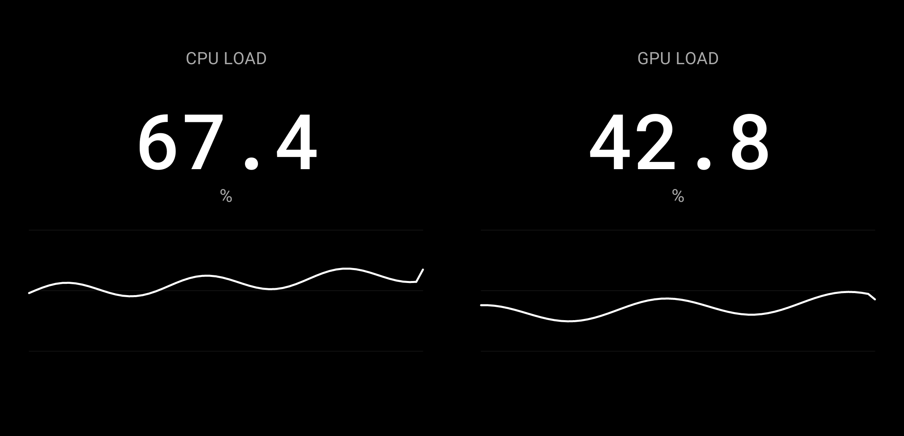
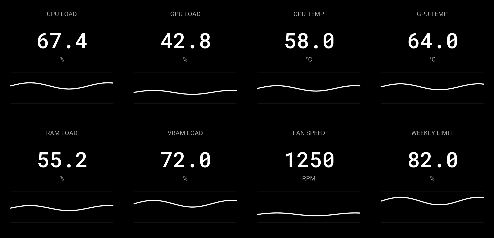
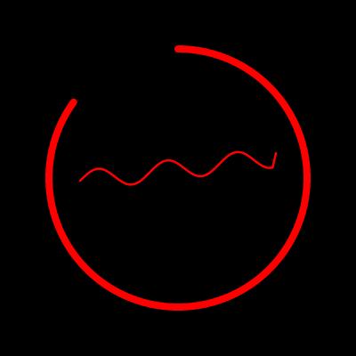

# Manitou CoolerControl

Неофициальный плагин **Lian Li UNI TL LCD / TL LCD Wireless** и
**TRYX Panorama 360** для
**CoolerControl 4.3.1 на Linux**, с управлением LCD и RGB через штатный интерфейс.
Версия Python-плагина: **0.5.4**. Проверено на Ubuntu 24.04, одном проводном
TL LCD 140, шести TL LCD Wireless и TRYX с контроллером `cm01_se`.

Проект состоит из Python-плагина и патча демона/веб-интерфейса CoolerControl.
Совместимая сборка устанавливается отдельно от пакетного демона.
Это независимый проект, не официальный продукт Lian Li, TRYX или CoolerControl.

## Возможности

- Независимые LCD 400×400: PNG/JPEG, GIF, карусель, яркость и поворот.
- TRYX LCD 2240×1080: изображения, GIF, яркость, поворот и те же источники датчиков.
- Температуры, RPM, CPU/GPU load, RAM/VRAM used, занятость выбранных дисковых разделов и остаток недельного лимита Codex.
- 15 оформлений Lian Li и 3 собственных горизонтальных оформления TRYX; графики с историей 60 точек и обновлением примерно раз в секунду.
- Mono Trace и Mono Reverse с цветовыми порогами, до 8 правил на экран.
- RGB проводных TL-контроллеров и уже привязанных TL LCD Wireless-групп.
- Подсветка TRYX через ARGB-разъёмы ASUS Aura USB `0b05:1aa6` (экспериментально).
- Симуляция устройств и тестирование без USB-оборудования.

| Mono Reverse | Mono Paper (Dark) |
| --- | --- |
|  |  |

## Совместимость

| Устройство | USB ID | Поддержка |
| --- | --- | --- |
| UNI TL LCD, проводной | `04fc:7393` | LCD |
| UNI TL LCD Wireless | `1cbe:0006` | LCD |
| TRYX Panorama 360, Android `cm01_se` | `18d1:2d04` | LCD, протокол `cm01` |
| TL hub | `0416:7372` | RGB, чтение RPM |
| Wireless RX / TX | `0416:8041` / `0416:8040` | RGB и RPM существующих групп |
| ASUS Aura USB motherboard | `0b05:1aa6` | ARGB-разъёмы; аппаратная проверка эффектов ожидается |

Плагин не изменяет PWM, привязку Wireless-групп или прошивку.
Скоростью управляют существующие устройства CoolerControl.
GPU/VRAM из **Lian Li System Metrics** используют NVIDIA `nvidia-smi`;
штатные RPM/load-каналы CoolerControl также доступны как LCD-источники.

Патч рассчитан **только на CoolerControl 4.3.1**, исходный commit
`b255e1e768eba4cec374acb0b463c942ee82d645`. Для другой версии нужна адаптация.
Патч исправляет классификацию LCD-режимов плагина, разделяет файлы кадров
между экранами и добавляет стили, метрики и планировщик обновления.

## Сборка и установка

Бинарники и wheels не хранятся в Git. Соберите их на целевой машине.
Нужны системный Python 3.10+, JDK 17+, Rust 1.90+, Node.js 22.12+ и npm.
Сборка проверена с Python 3.12 и Rust 1.90.

Базовые зависимости Ubuntu:

```bash
sudo apt install git python3-venv build-essential pkg-config libdrm-dev libusb-1.0-0 protobuf-compiler openjdk-21-jdk-headless curl
```

После установки Rust и Node.js:

```bash
git clone https://github.com/ogladkov/manitou-cooler-control.git
cd manitou-cooler-control
/usr/bin/python3 -m venv .venv
.venv/bin/pip install -e '.[dev]'
.venv/bin/pytest -q
.venv/bin/ruff check src/lianli_lcd tests scripts/install-openai-limits.py
bash scripts/prepare-wheels.sh
bash scripts/build-compat.sh
sudo bash scripts/install.sh --with-compat
sudo systemctl restart coolercontrold
```

`build-compat.sh` получает закреплённые исходники, применяет
[патч](patches/coolercontrol-4.3.1-plugin-lcd.patch), создаёт миниатюры,
проверяет UI/Rust и собирает демон со встроенным веб-интерфейсом.
Без системного `protoc` используется `scripts/protoc` из `.venv`.

Установщик использует wheels из `artifacts/wheels/` офлайн и создаёт
`/opt/cc-lianli-lcd` и systemd override. Пакетный `/usr/bin/coolercontrold`
не перезаписывается. Настройки и кривые сохраняются. Перезапуск кратковременно
прерывает управление охлаждением.

Обновите страницу CoolerControl. Откройте **Lian Li UNI TL LCD** или
**Lian Li UNI TL LCD Wireless** или **TRYX PANORAMA 360** → **LCD** → режим, источник и стиль → **Сохранить**.

Для последующих обновлений после пересборки:

```bash
# Только Python-плагин:
sudo bash scripts/install.sh
# Только совместимый демон и стили:
sudo bash scripts/update-styles.sh
sudo systemctl restart coolercontrold
```

## TRYX Panorama 360

Поддерживается проверенная Android/CDC-ревизия: USB `18d1:2d04`,
модель `cm01_se`, протокол `cm01`, экран 2240×1080. Другие ревизии,
включая новые устройства с USB `391a:*`, этим драйвером не обслуживаются.
Обнаружение требует совпадения модели, производителя и CDC-порта;
произвольные Android-устройства не добавляются.

Установите зависимости на хосте:

```bash
sudo apt install adb ffmpeg
```

После обновления Python-плагина и перезапуска CoolerControl появится
**TRYX PANORAMA 360 → LCD**. Уже установленный совместимый демон 4.3.1
нужно обновить для новых форматов экрана (см. ниже). Доступны Image/GIF,
Sensor, Carousel, яркость 0–100 и поворот 0/90/180/270°.

В режиме **Sensor / Показатель** TRYX показывает только собственные оформления:

| Стиль | Вид |
| --- | --- |
| Panorama Minimal | Крупное значение, единица и горизонтальная шкала |
| Panorama Scope | Значение и график истории |
| Panorama Trace | Только график на чёрном фоне |

**Формат экрана TRYX → Цельный экран** — один показатель на холсте 2240×1080.
**Две половины** — две независимые зоны по 1120×1080, граница по сгибу экрана.
Для левой и правой половины выбираются свои источник, стиль и цветовые пороги.
По умолчанию оформление монохромное; пороги меняют цвет при достижении значения.
История каждого графика содержит до 60 отсчётов и обновляется раз в секунду.
Пропавшие данные одной половины не останавливают другую.



**8 датчиков / 8 sensors** — по сетке 2×2 на каждой плоскости, всего восемь
ячеек 560×540. Порядок: 1–2 сверху и 3–4 снизу слева; 5–6 сверху и 7–8 снизу
справа. Для каждой ячейки выберите источник и стиль; цветовые пороги раскрываются
отдельно. Все восемь источников обязательны, один датчик можно повторять.
Каждая ячейка хранит свою историю графика. Данные обновляются раз в секунду;
пропавший источник не останавливает остальные. При переключении формата
несохранённые настройки ячеек сохраняются до закрытия страницы.



Квадратные стили вентиляторов в списке TRYX не показываются. Старый Mono Trace
на TRYX автоматически отображается как Panorama Trace; графические стили —
как Panorama Scope, остальные — как Panorama Minimal. Файлы изображений/GIF
сохраняют пропорции, но оформление датчиков рисуется сразу в родном разрешении.

Для обновления только макетов LCD при установленном Python-плагине 0.5.1 или новее
достаточно обновить совместимый демон (датчики дисков требуют Python-плагин 0.5.2):

```bash
bash scripts/build-compat.sh
sudo bash scripts/update-styles.sh
sudo systemctl restart coolercontrold
```

После перезапуска обновите страницу и выберите формат в **TRYX PANORAMA 360 → LCD**.
Настройки обеих половин сохраняются в конфигурации CoolerControl.

В 0.5.1 изображения и кадры датчиков передаются через постоянный канал ADB
в небольшой рендерер плагина на устройстве. Он заменяет готовый буфер экрана
целиком: предыдущий кадр остаётся виден во время передачи и декодирования.
Приложение TRYX больше не переключает оформление на каждом кадре, что
устраняет обнаруженное мигание. Кадры находятся в RAM и не записываются
в `/sdcard/pcMedia`. Яркость отправляется только при изменении.

Рендерер запускается как процесс `app_process` от пользователя ADB shell;
APK не устанавливается, системные приложения и прошивка не меняются.
Собственный DEX-файл хранится в `/data/local/tmp/manitou-tryx-<hash>.dex`.
При закрытии плагина слой освобождается; без связи процесс завершается
через 90 секунд. Проверена Android 11-ревизия `cm01_se`.
Сборка рендерера из `android/tryx/FrameServer.java` выполняется автоматически
в `scripts/prepare-wheels.sh`; JDK нужен только на машине сборки.
Для запуска непосредственно из исходников сначала выполните
`bash scripts/build-tryx-renderer.sh`.

ADB всегда адресует серийный номер обнаруженного TRYX. GIF по-прежнему
преобразуется FFmpeg в H.264 для встроенного плеера; в `/sdcard/pcMedia`
остаются до двух последних медиафайлов плагина. Файлы Kanali и пользователя
не удаляются. Не запускайте одновременно другие приложения управления TRYX.
При ошибке ADB проверьте `adb devices -l` и доступ к USB.

Связь с устройством и рендерером проверяется раз в 10 секунд. В проверке
обновлённый JPEG-кадр передавался за 0,066–0,093 секунды; целевой интервал
графиков CoolerControl остаётся 1 секунда. Неизменное изображение повторно
не передаётся. Переключение между статическим изображением и GIF может
потребовать краткой подготовки встроенного плеера.
GIF: до 600 кадров и 60 секунд; преобразованный ролик — до 20 MiB.
Управление помпой, вентиляторами TRYX и прошивкой не добавляется.

## Показатели и стили

В режиме **Показатель / Sensor** доступны температуры, RPM и проценты.
CPU load, RAM used, NVIDIA GPU load и VRAM used находятся в **Lian Li System Metrics**.
RAM использует MemAvailable, VRAM — долю занятой видеопамяти.
RPM обнаруженных вентиляторов находятся у RGB-устройств.

Сбор показаний и целевое обновление LCD — примерно раз в секунду при
`poll_rate = 1.0`. Если предыдущая передача ещё идёт, следующий цикл пропускается.
История 60 точек — примерно минута; она очищается при сохранении настройки
и перезапуске. Шкалы: 0–100 для °C/%, 0–4000 для RPM.

| Стиль | Вид |
| --- | --- |
| CoolerControl | Исходное оформление |
| Digital, Ring, Dial, Trend | Цифры, кольцо, циферблат, график |
| Mono Minimal, Mono Dial, Mono Segment | Монохромная типографика, шкала, сегменты |
| Mono Paper | Светлые показания и график на чёрном фоне |
| Alien Orbit, Alien Relic, Alien Signal | Монохромные геометрические оформления |
| Mono Trace | Только график; опциональные цветовые пороги |
| Mono Reserve | Исчезающее кольцо без цифр |
| Mono Reverse | Кольцо и график одного источника внутри; настраиваемые цветовые пороги |

**Mono Trace:** добавьте правило «При значении ≥» и цвет в настройках LCD.
Наибольший достигнутый порог окрашивает весь график; без правил линия белая.
Правила сохраняются отдельно для каждого экрана. При смене источника
проверьте единицы порогов. При отсутствии данных график чёрный.

**Mono Reserve / Mono Reverse:** длина дуги соответствует текущему значению.
Для остатка лимита 100% — полное кольцо, 0% — отсутствие кольца.
В Mono Reverse история остаётся видна при 0%; нет данных — `--`.
Для **Mono Reverse** задайте критическое значение через **Цветовые пороги графика →
Добавить порог** и выберите цвет. Например, при значении **≥ 85%** кольцо и график
станут красными; ниже порога — снова белыми. Можно добавить до восьми порогов:
действует наибольший достигнутый. Единицы соответствуют источнику: %, °C или RPM.
Удаление всех правил возвращает обычное монохромное оформление. Правила сохраняются
для каждого LCD вместе с остальными настройками.



В 0.4.1 проводной TL LCD повторяет последний кадр каждую секунду даже при
неизменном показателе. Длинные кадры GIF повторяются без ускорения анимации;
Wireless-изображения не требуют такого повтора.

## Занятость дисковых разделов

С версии 0.5.2 каждый смонтированный локальный раздел появляется отдельным
источником в **Lian Li System Metrics**: `Disk /`, `Disk Red`, `Disk blue` и т. п.
В каждой ячейке TRYX (включая режим 8 датчиков) или на любом Lian Li LCD выберите
нужный `Disk …` в списке источников. Можно вывести разные разделы или повторить
один и тот же. Работают существующие стили, графики и цветовые пороги.

Показание — процент занятого места, рассчитанный как у `df` до округления:
занято / (занято + доступно обычному пользователю). Зарезервированные блоки
не считаются доступным местом. Опрос выполняется раз в 5 секунд в отдельном
потоке; CPU/GPU и LCD продолжают обновляться раз в секунду. Читается только
метаинформация файловой системы, содержимое файлов не сканируется.

Список разделов определяется при запуске плагина. После добавления нового
раздела или изменения его точки монтирования перезапустите `coolercontrold`.
Сетевые, временные и служебные виртуальные файловые системы не добавляются.
При размонтировании/ошибке показание становится недоступным (`--` в числовом
стиле), устаревшие данные отбрасываются через 15 секунд. Раздел не подменяется
родительской файловой системой. Повторное монтирование того же устройства в
ту же точку восстанавливает показания.

Для отображения дисков в списке источников нужны Python-плагин 0.5.2 и
обновлённый совместимый демон с поддержкой дисковых источников в интерфейсе.
Подготовьте wheels через `scripts/prepare-wheels.sh`, демон через
`scripts/build-compat.sh`, затем обновите существующую установку:

```bash
sudo bash scripts/install.sh --with-compat
sudo systemctl restart coolercontrold
```

Если Python-плагин 0.5.2 уже установлен, достаточно `sudo bash scripts/update-styles.sh`
и перезапуска службы. После перезапуска обновите страницу через Ctrl+F5.

## Недельные лимиты Codex (опционально)

**Codex weekly left** — остаток недельного лимита Codex по подписке ChatGPT,
а не лимиты обычного чата или API billing. Нужны Codex CLI и вход у
desktop-пользователя в стандартном `~/.codex`.

Если нужен прокси, сохраните его настройки из рабочего терминала **без sudo**:

```bash
python3 scripts/install-openai-limits.py --prepare
```

После сборки установите сборщик:

```bash
sudo bash scripts/install.sh --with-compat --with-openai-limits
sudo systemctl restart coolercontrold
```

Выберите **Показатель → Lian Li System Metrics → Codex weekly left** и стиль.
Служба читает `account/rateLimits/read` раз в минуту от пользователя, вызвавшего
`sudo`. Запросов к модели нет. USB-плагин читает очищенный снимок 0600 в
`/var/lib/cc-lianli-lcd-limits/usage.json`; авторизация не копируется.
Снимок старше 180 секунд, ошибка запроса или наступивший сброс означают
отсутствие данных. Для новых видов лимитов перезапустите CoolerControl.

Proxy-конфигурация находится в игнорируемом `build/`; установщик переносит
её в закрытый `/opt/cc-lianli-lcd/openai-limits.env`. После смены прокси
повторите `--prepare` и установку сборщика.

## RGB

RGB-канал → **Lighting / Подсветка** → эффект → **Сохранить**.
Доступны Off, Static, Rainbow, Color cycle, Meteor, Wave;
для Wireless также Breathing. У применимых эффектов есть цвет, скорость и направление.
Проводной канал управляет портом TL hub, Wireless — существующей группой.
Применение эффекта отключает синхронизацию RGB с материнской платой.
Не запускайте одновременно другую программу, управляющую теми же USB LCD/RGB.

### Подсветка TRYX через материнскую плату

Если 3-контактный ARGB-кабель вентиляторов TRYX подключён к материнской плате,
подсветкой управляет её контроллер, отдельно от USB-экрана TRYX.
В Python-плагине **0.5.4** добавлен ASUS Aura USB `0b05:1aa6`
(обнаружен на ROG CROSSHAIR X870E HERO). Поддержка экспериментальная:
протокол и интеграция покрыты тестами, эффекты на этом компьютере ещё не проверены.

После установки Python-плагина и перезапуска CoolerControl откройте
**ASUS Aura ARGB → ARGB · Header 1/2/3 → Lighting / Подсветка**.
Число каналов читается из контроллера; пустые разъёмы тоже отображаются,
автоматически определить подключение именно TRYX невозможно.
Выберите разъём с кабелем TRYX. Доступны **Off, Static, Breathing, Flashing,
Spectrum Cycle, Rainbow**; первые три цветных эффекта позволяют выбрать цвет.
Управление скоростью и направлением эффекта не заявляется.
Вентиляторы на одном разветвителе получают общий эффект.

Настройки сохраняются и восстанавливаются CoolerControl. Плагин не записывает
эффекты в память контроллера и не меняет режим подсветки выключенного ПК.
Обнаружение выполняет только запросы версии/конфигурации; подсветка самой платы
и 12V RGB-разъёмы не добавляются как управляемые каналы. При применении эффекта контроллер переключается в совместимый режим Gen1
командой, используемой OpenRGB. Это переключение общее для Aura, а цвет и эффект
адресуются только выбранному разъёму. В 0.5.3 этот шаг был пропущен, из-за чего
контроллер в Gen2 мог принимать команды без включения подсветки.
OpenRGB для работы плагина не нужен; одновременно управлять Aura из него нельзя.

Для обновления достаточно `sudo bash scripts/install.sh` и
`sudo systemctl restart coolercontrold`; пересборка совместимого демона не нужна.
Для диагностики только Aura, без изменения подсветки:

```bash
sudo /opt/cc-lianli-lcd/venv/bin/cc-lianli-lcd probe-aura
```

При ошибке чтения контроллер не добавляется, причина видна в выводе диагностики
и журнале плагина; LCD и существующие Lian Li RGB продолжают работать.

## Разработка и диагностика

```bash
.venv/bin/cc-lianli-lcd list
.venv/bin/cc-lianli-lcd serve --simulate --socket /tmp/lianli-lcd-dev/service.sock --image-root "$PWD"
```

`list` читает только sysfs. Симуляция предоставляет 7 LCD, RGB-устройства
и системные метрики через тот же gRPC API, без USB-доступа.
Добавьте `--simulate-tryx`, чтобы проверить восьмой LCD 2240×1080 без USB/ADB.
Для установленной версии:

```bash
systemctl status coolercontrold cc-plugin-lianli-lcd
journalctl -u coolercontrold -u cc-plugin-lianli-lcd -n 100 --no-pager
systemctl status cc-lianli-openai-limits.timer
```

Структура и проверки: [CONTRIBUTING.md](CONTRIBUTING.md),
[docs/verification.md](docs/verification.md).

## Ограничения и удаление

- Загрузка готового MP4 не поддерживается; для TRYX GIF конвертируется в H.264.
  Нет обновления прошивки и записи boot image.
- Lian Li GIF: до 15 кадров/с; пределы — 20 MiB входа, 600 кадров,
  32 MiB декодированных JPEG и 101888 байт на JPEG.
- ID привязаны к USB-топологии; смена порта создаёт новый ID.
  После изменения состава оборудования нужен перезапуск.
- Изображения читаются из `/etc/coolercontrol` и `/var/lib/coolercontrol`.
  Для другого каталога добавьте `--image-root` в манифест.
- Тесты не гарантируют совместимость с любой прошивкой.

Возврат к пакетному CoolerControl:

```bash
sudo bash scripts/uninstall.sh
sudo systemctl restart coolercontrold
```

Удаляются регистрация и override; файлы в `/opt`, настройки и кривые сохраняются.

## Лицензия

[GPL-3.0-or-later](LICENSE). Заимствованные протоколы и protobuf:
[THIRD_PARTY.md](THIRD_PARTY.md). При распространении совместимого бинарника
предоставляйте соответствующие исходники CoolerControl, патч и лицензии.
